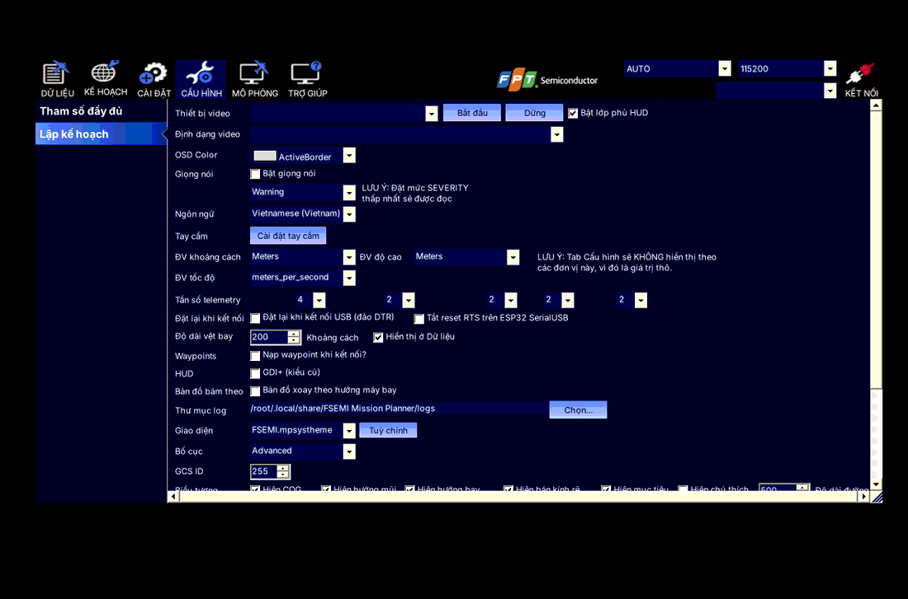
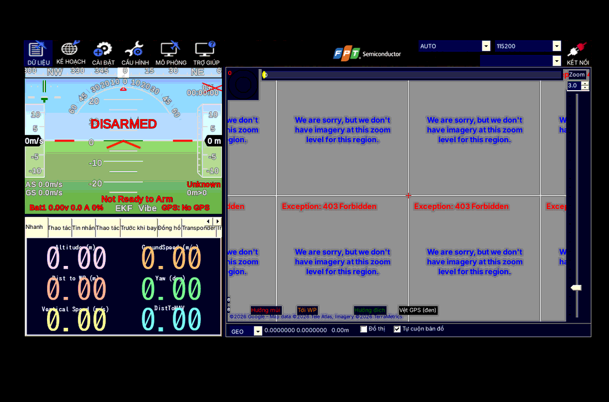
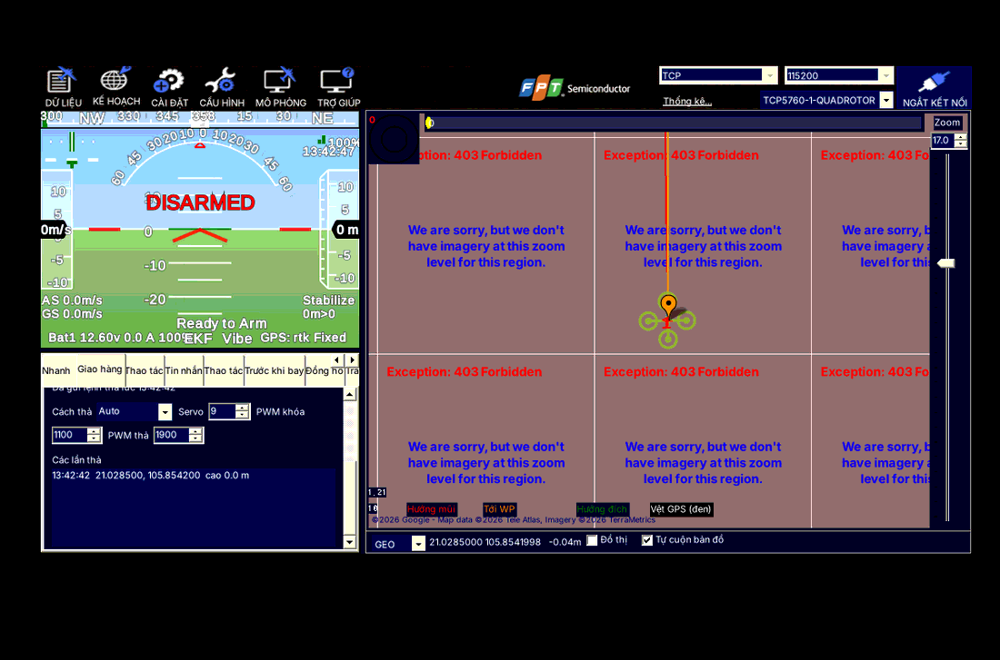
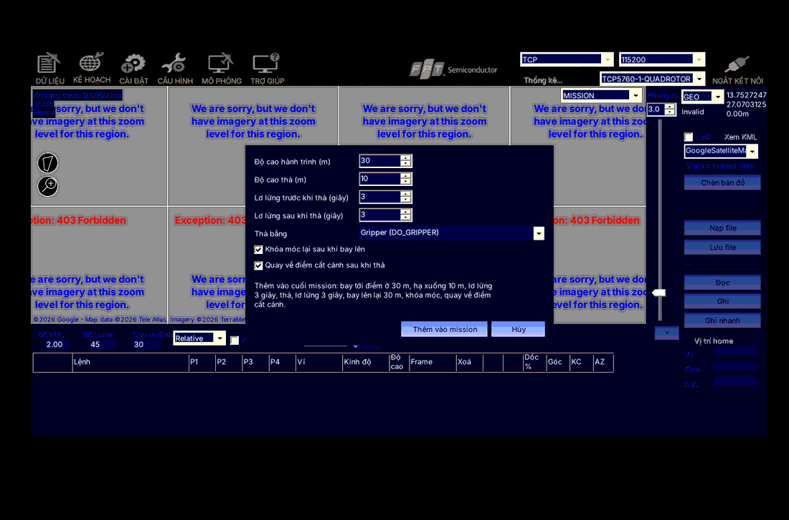
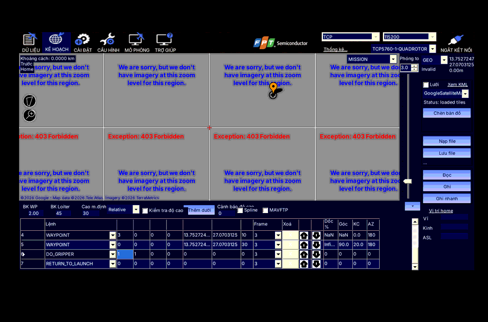
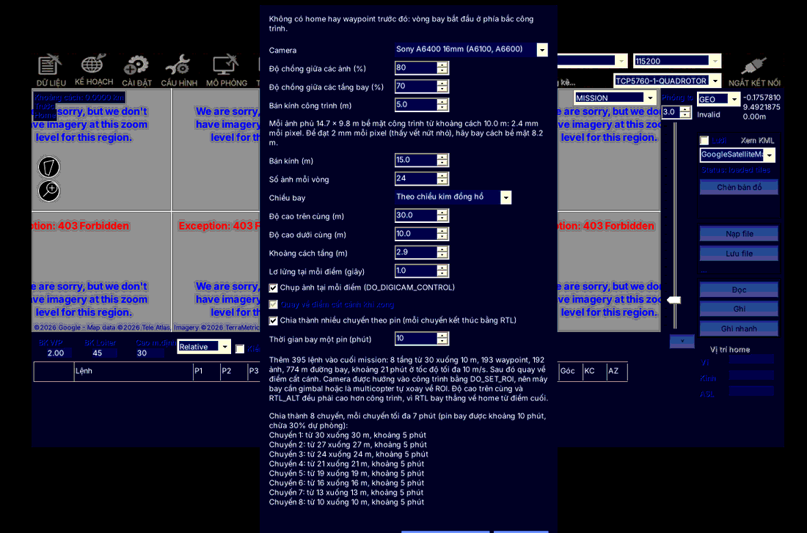
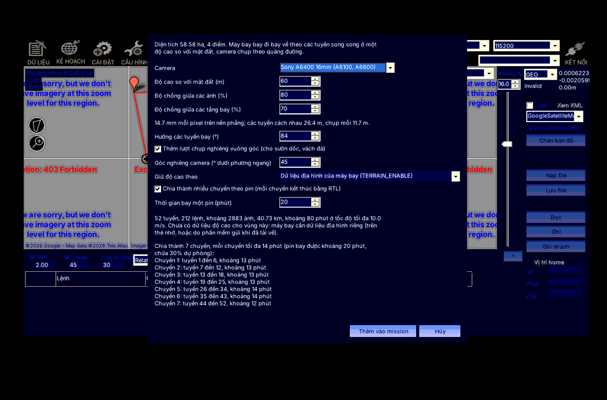
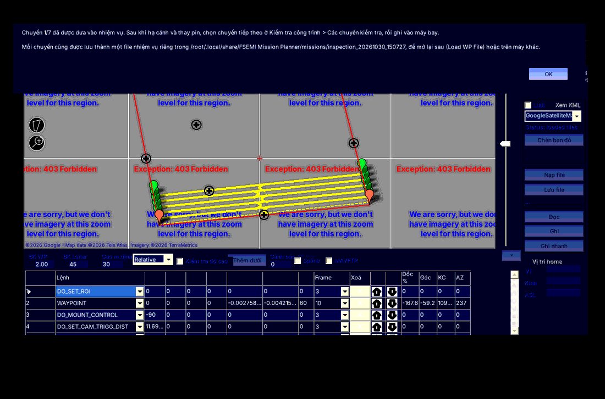
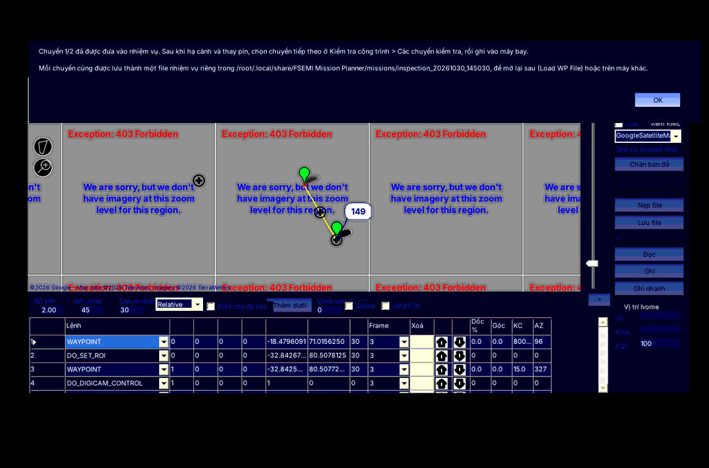
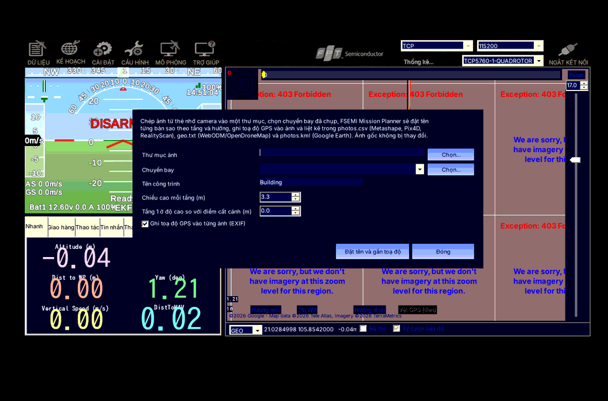

# Hướng dẫn sử dụng FSEMI Mission Planner

Tài liệu này hướng dẫn dùng các chức năng riêng của **FSEMI Mission Planner** (phiên bản 1.0.0):

- giao hàng;
- chụp ảnh để dựng mô hình 3D cho công trình;
- chụp ảnh để dựng mô hình 3D cho đồi núi, dãy núi;
- chia chuyến theo pin;
- xử lý ảnh sau chuyến bay.

Các chức năng còn lại giống Mission Planner, xem tài liệu tại
[ardupilot.org/planner](https://ardupilot.org/planner/).

Ảnh minh hoạ chụp từ giao diện tiếng Việt, khi chạy với máy bay giả lập (SITL), nên bản đồ nền
không có ảnh vệ tinh.

## Mục lục

1. [Bắt đầu](#1-bắt-đầu)
2. [Giao hàng](#2-giao-hàng)
3. [Chụp ảnh 3D cho công trình](#3-chụp-ảnh-3d-cho-công-trình)
4. [Chụp ảnh 3D cho đồi núi, dãy núi](#4-chụp-ảnh-3d-cho-đồi-núi-dãy-núi)
5. [Chia chuyến theo pin](#5-chia-chuyến-theo-pin)
6. [Xử lý ảnh sau chuyến bay](#6-xử-lý-ảnh-sau-chuyến-bay)
7. [Dựng mô hình 3D](#7-dựng-mô-hình-3d)
8. [Câu hỏi thường gặp](#8-câu-hỏi-thường-gặp)

---

## 1. Bắt đầu

### 1.1. Cài đặt và mở phần mềm

1. Tải `FSEMIMissionPlannerBeta.zip` (bản build thử ở mục
   [Releases → test-build](https://github.com/wshien90/MissionPlanner/releases/tag/test-build)).
2. Giải nén vào một thư mục, ví dụ `C:\FSEMI Mission Planner`.
3. Chạy `FSEMIMissionPlanner.exe`.

FSEMI Mission Planner có thư mục dữ liệu riêng (`Documents\FSEMI Mission Planner`), nên cài chung
máy với Mission Planner hay bigWing Command được mà không lẫn cài đặt.

### 1.2. Chọn tiếng Việt

1. Bấm **CONFIG** (CẤU HÌNH) → **Planner**.
2. Ở **UI Language**, chọn **Tiếng Việt (vi-VN)**.
3. Đóng rồi mở lại phần mềm.

Ở cùng màn hình này:

- **Giao diện (Theme)**: mặc định là `FSEMI.mpsystheme` (màu FPT Semiconductor). Theme xanh lá
  của Mission Planner là `BurntKermit.mpsystheme`.
- **Giọng nói**: bật **Bật giọng nói** để phần mềm báo khi thả hàng.

### 1.3. Màn hình chính

- **DỮ LIỆU**: theo dõi chuyến bay (HUD, bản đồ, các tab bên dưới HUD).
- **KẾ HOẠCH**: lập nhiệm vụ trên bản đồ.

Các chức năng FSEMI nằm ở:

- tab **Giao hàng** dưới HUD;
- menu chuột phải trên bản đồ **KẾ HOẠCH** (Thả hàng tại đây, Kiểm tra công trình);
- menu chuột phải trên bản đồ **DỮ LIỆU** (Ảnh kiểm tra công trình...).

Bấm logo FPT Semiconductor ở góc trên bên phải sẽ mở trang
[fpt-semiconductor.com](https://fpt-semiconductor.com/).

---

## 2. Giao hàng

### 2.1. Tab Giao hàng: khoá và thả hàng

Mở **DỮ LIỆU** → tab **Giao hàng** (ngay sau tab Nhanh).

- **Trạng thái** (dải màu trên cùng): **ĐÃ KHÓA** (xanh lá), **ĐÃ THẢ** (cam) hoặc **KHÔNG RÕ**
  (xám). Phần mềm đọc trạng thái từ đầu ra servo của móc hàng.
- **KHÓA**: gửi lệnh khoá móc hàng.
- **THẢ**: phần mềm hỏi lại kèm độ cao và tốc độ hiện tại, rồi mới gửi lệnh thả. Nếu máy bay
  chưa arm, phần mềm cũng nhắc.
- **Cách thả**:
  - **Auto**: nếu máy bay bật `GRIP_ENABLE` thì dùng gripper của ArduPilot, nếu không thì dùng
    servo;
  - **Gripper**: lệnh `DO_GRIPPER`, dùng `GRIP_GRAB` / `GRIP_RELEASE` và servo có
    `SERVOn_FUNCTION = 28`;
  - **Servo**: lệnh `DO_SET_SERVO` trên kênh **Servo** (mặc định 9), với **PWM khóa** (mặc định
    1100) và **PWM thả** (mặc định 1900).
- **Các lần thả**: danh sách thời gian, toạ độ, độ cao của mỗi lần thả trong phiên làm việc.
  - Lần thả do máy bay tự làm (theo nhiệm vụ hoặc công tắc RC) cũng được ghi, kèm chữ
    "(mission/RC)".
  - Mỗi lần thả có một điểm màu cam trên bản đồ **DỮ LIỆU**.

> **An toàn:** thử KHÓA/THẢ khi máy bay còn dưới đất và chưa gắn hàng, để chắc PWM khoá/thả
> đúng với móc của bạn.

### 2.2. Lập nhiệm vụ thả hàng

1. Mở **KẾ HOẠCH**. Bảo đảm ô loại nhiệm vụ đang là **MISSION** (không phải Fence hay Rally).
2. Chuột phải vào điểm cần giao trên bản đồ → **Thả hàng tại đây**.
3. Điền hộp thoại:
   - **Độ cao hành trình**: độ cao bay tới và rời điểm thả.
   - **Độ cao thả**: độ cao lúc thả. Phải thấp hơn độ cao hành trình.
   - **Lơ lửng trước khi thả** / **sau khi thả** (giây): cho máy bay đứng yên trước và sau khi
     mở móc.
   - **Thả bằng**: Gripper (`DO_GRIPPER`) hoặc Servo (`DO_SET_SERVO`).
   - **Khóa móc lại sau khi bay lên** và **Quay về điểm cất cánh sau khi thả**: tuỳ chọn.
4. Bấm **Thêm vào mission**.

Phần mềm thêm vào cuối nhiệm vụ lần lượt:

1. bay tới điểm ở độ cao hành trình;
2. hạ xuống độ cao thả và lơ lửng;
3. thả;
4. lơ lửng;
5. bay lên độ cao hành trình;
6. (tuỳ chọn) khoá móc;
7. (tuỳ chọn) RTL.

Điểm thả được đánh dấu màu cam trên bản đồ. Muốn giao nhiều điểm, lặp lại cho từng điểm và bỏ
chọn RTL ở các điểm trước điểm cuối.

Cuối cùng bấm **Ghi** để nạp nhiệm vụ vào máy bay.

---

## 3. Chụp ảnh 3D cho công trình

Dùng cho tháp, cột điện, trụ cầu, toà nhà: máy bay bay từng tầng, từ trên xuống, camera luôn
hướng vào công trình, chụp một ảnh ở mỗi điểm.

**Chuẩn bị:**

- Camera được điều khiển chụp bằng `DO_DIGICAM_CONTROL`, ví dụ `CAM1_TYPE` và servo hoặc relay
  kích chụp.
- Máy bay có gimbal, hoặc là multicopter tự xoay mũi theo ROI.

### 3.1. Bay vòng quanh công trình (tháp, cột, trụ)

1. **KẾ HOẠCH** → chuột phải vào **tâm công trình** → **Kiểm tra công trình** → **Bay vòng
   quanh công trình tại đây...**
2. Chọn **Camera**, ví dụ *Sony A6400 16mm (A6100, A6600)*, đây là mặc định. Chọn **Tự nhập**
   nếu muốn nhập số tay.
3. Điền:
   - **Độ chồng giữa các ảnh** (mặc định 80%) và **Độ chồng giữa các tầng bay** (mặc định 70%);
   - **Bán kính công trình**: bán kính của công trình, khoảng từ tâm ra mặt ngoài;
   - **Bán kính**: bán kính vòng bay. Phải lớn hơn bán kính công trình, an toàn ít nhất 5 m;
   - **Độ cao trên cùng** / **dưới cùng**: tầng bay cao nhất và thấp nhất (so với điểm cất cánh);
   - **Chiều bay**: theo hoặc ngược chiều kim đồng hồ.
4. Phần mềm tự tính **Số ảnh mỗi vòng** và **Khoảng cách tầng**. Dòng chữ dưới các ô cho biết
   mỗi ảnh phủ bao nhiêu mét và bao nhiêu mm mỗi pixel. Muốn thấy vết nứt nhỏ thì nên dưới 2 mm
   mỗi pixel.
5. Xem phần tóm tắt (số lệnh, số ảnh, quãng đường, thời gian) và các cảnh báo màu đỏ.
6. Bấm **Thêm vào mission**.

### 3.2. Bay dọc mặt tường (mặt đứng toà nhà)

1. Chuột phải vào **một đầu tường** → **Kiểm tra công trình** → **Mặt đứng: đầu tường tại
   đây**.
2. Chuột phải vào **đầu kia của tường** → **Kiểm tra công trình** → **Mặt đứng: cuối tường tại
   đây...**
3. Chọn **Bay ở phía** (bên máy bay tới, hoặc bên kia tường) và **Khoảng cách tới tường**.
4. Các ô còn lại giống phần 3.1. Phần mềm tự tính **Khoảng cách chụp dọc tường**.

### 3.3. Gợi ý

- Độ cao dưới cùng ít nhất 3 m. RTL_ALT phải cao hơn công trình, vì RTL bay thẳng về.
- Dưới 5 m tới công trình là nguy hiểm, phần mềm sẽ cảnh báo.
- Nhiệm vụ quá dài thì bật **Chia thành nhiều chuyến theo pin** (xem [phần 5](#5-chia-chuyến-theo-pin)).

---

## 4. Chụp ảnh 3D cho đồi núi, dãy núi

Máy bay bay đi bay về theo các tuyến song song trên một vùng, ở **độ cao cố định so với mặt
đất**. Camera chụp theo quãng đường. Có thể thêm **lượt chụp nghiêng** vuông góc để thấy rõ sườn
dốc và vách đá.

### 4.1. Vẽ vùng cần chụp

1. **KẾ HOẠCH** → chuột phải trên bản đồ → **Đa giác** → **Vẽ đa giác**.
2. Bấm lần lượt các điểm bao quanh đồi hoặc dãy núi, ít nhất 3 điểm. Đường đỏ là ranh giới vùng.

### 4.2. Lập nhiệm vụ chụp địa hình

1. Chuột phải trong vùng → **Kiểm tra công trình** → **Chụp ảnh địa hình vùng đa giác (3D)...**
2. Điền hộp thoại:
   - **Camera**, **Độ cao so với mặt đất** (mặc định 60 m), **Độ chồng giữa các ảnh** (80%),
     **Độ chồng giữa các tuyến bay** (70%). Phần mềm báo mm mỗi pixel, khoảng cách giữa các
     tuyến và khoảng cách giữa các lần chụp.
   - **Hướng các tuyến bay (°)**: mặc định theo cạnh dài nhất của vùng, để ít phải quay đầu.
   - **Thêm lượt chụp nghiêng vuông góc** (bật sẵn) và **Góc nghiêng camera** (mặc định 45° dưới
     phương ngang). Nên bật cho vùng dốc, vách đá, thung lũng hẹp.
   - **Giữ độ cao theo** (xem 4.3).
   - **Chia thành nhiều chuyến theo pin** và **Thời gian bay một pin (phút)**.
3. Xem phần tóm tắt:
   - số tuyến, số lệnh, số ảnh ước tính, quãng đường, thời gian bay;
   - độ cao thấp nhất và cao nhất của mặt đất (khi đã có dữ liệu SRTM);
   - danh sách các chuyến.
4. Bấm **Thêm vào mission**.

### 4.3. Giữ độ cao so với mặt đất

| Lựa chọn | Cách hoạt động | Cần gì |
|---|---|---|
| **Dữ liệu địa hình của máy bay (TERRAIN_ENABLE)** (khuyên dùng) | Waypoint dùng khung độ cao theo địa hình (Frame 10). Máy bay tự giữ độ cao so với mặt đất, kể cả giữa hai waypoint. | Đặt `TERRAIN_ENABLE = 1`. Máy bay cần dữ liệu địa hình, có sẵn trên thẻ nhớ hoặc do phần mềm gửi khi đang kết nối. Phần mềm cảnh báo nếu `TERRAIN_ENABLE = 0`. |
| **Dữ liệu độ cao (SRTM) của phần mềm** | Phần mềm tra độ cao mặt đất dọc mỗi tuyến, cứ 30 m thêm một waypoint, ở độ cao = mặt đất + độ cao đã chọn (so với mực nước biển). | Dữ liệu SRTM của vùng đã được tải về máy. |

**SRTM là gì?** SRTM là dữ liệu độ cao mặt đất của gần như toàn Trái Đất, do NASA đo bằng radar
năm 2000.

- **Độ chi tiết:** ô khoảng 30–90 m.
- **Sai số:** khoảng ±5–10 m.
- **Đo mặt trên cùng:** ngọn cây, mái nhà, không phải đất trần.
- **Nguồn:** phần mềm tự tải từ Internet và lưu ở thư mục `srtm`.

> **Ngoài hiện trường không có mạng:** trước khi đi, mở vùng bay trên bản đồ và mở hộp thoại
> chụp ảnh địa hình một lần khi còn mạng, để phần mềm tải sẵn dữ liệu SRTM.
>
> **An toàn:** vì sai số và cây cối, ở vùng có rừng nên bay từ 60 m trở lên so với mặt đất. Bay
> cao hơn 120 m so với mặt đất cần giấy phép bay, phần mềm sẽ cảnh báo.

---

## 5. Chia chuyến theo pin

Áp dụng cho cả chụp ảnh công trình và chụp ảnh địa hình.

1. Bật **Chia thành nhiều chuyến theo pin (mỗi chuyến kết thúc bằng RTL)** và nhập **Thời gian
   bay một pin (phút)**.
2. Phần mềm luôn chừa **30% dự phòng**.
   - Ví dụ pin bay 20 phút thì mỗi chuyến tối đa 14 phút.
   - Thời gian tính cả cất cánh, hạ cánh và quãng đường bay từ home tới và về.
3. Cách chia:
   - công trình: chia theo **tầng**, từ trên xuống;
   - địa hình: chia theo **tuyến**, theo thứ tự.

   Danh sách các chuyến hiện ngay trong hộp thoại.
4. Khi bấm **Thêm vào mission**:
   - **chuyến 1** được đưa vào nhiệm vụ;
   - **mỗi chuyến** được lưu thành một file nhiệm vụ riêng, trong
     `Documents\FSEMI Mission Planner\missions\inspection_<ngày>_<giờ>\flight_<n>_of_<tổng>.waypoints`.

**Bay các chuyến tiếp theo:**

1. Bay xong chuyến 1, hạ cánh, thay pin.
2. **KẾ HOẠCH** → chuột phải → **Kiểm tra công trình** → **Các chuyến kiểm tra** → chọn chuyến
   tiếp theo. Phần mềm hỏi lại, rồi thay các dòng của chuyến cũ bằng chuyến mới.
3. Bấm **Ghi** để nạp vào máy bay.

Ở máy khác, hoặc khi đã đóng phần mềm, dùng **Nạp file** để mở file `.waypoints` của chuyến cần
bay. Mục **Mở thư mục chứa file các chuyến** mở nhanh thư mục này.

---

## 6. Xử lý ảnh sau chuyến bay

Trong mỗi chuyến bay, từ lúc arm đến lúc disarm, phần mềm ghi lại **vị trí chụp từng ảnh** (từ
CAMERA_FEEDBACK của máy bay). Các vị trí được lưu ở
`Documents\FSEMI Mission Planner\photos\flight_<ngày>_<giờ>_photos.csv`. Phần mềm cần đang kết
nối với máy bay trong suốt chuyến bay.

Sau chuyến bay:

1. Chép ảnh từ thẻ nhớ camera vào một thư mục trên máy tính.
2. **DỮ LIỆU** → chuột phải trên bản đồ → **Ảnh kiểm tra công trình...**
3. Điền:
   - **Thư mục ảnh**: thư mục vừa chép ảnh vào;
   - **Chuyến bay**: chuyến đã chụp, chuyến mới nhất ở trên cùng;
   - **Tên công trình**: dùng để đặt tên ảnh;
   - **Chiều cao mỗi tầng** và **Tầng 1 ở độ cao so với điểm cất cánh**: để tính ảnh thuộc tầng
     nào;
   - **Ghi toạ độ GPS vào từng ảnh (EXIF)**: nên bật.
4. Bấm **Đặt tên và gắn toạ độ**.

**Kết quả:**

- Phần mềm tạo thư mục `FSEMI_<tên công trình>` bên cạnh thư mục ảnh.
- Mỗi ảnh được đặt tên theo tầng và hướng, ví dụ `ToaA_F03_NE_0012.jpg` là tầng 3, hướng Đông
  Bắc, ảnh số 12. Ảnh chụp từ trên đỉnh có hướng `TOP`.
- Toạ độ GPS được ghi vào từng ảnh. Ảnh gốc không bị thay đổi.
- Kèm theo các danh sách:
  - `photos.csv`: dùng cho Metashape, Pix4D, RealityScan;
  - `geo.txt`: dùng cho WebODM / OpenDroneMap;
  - `photos.kml`: mở bằng Google Earth, xem vị trí ảnh theo tầng.

Phần mềm ghép ảnh với vị trí theo thứ tự nếu số ảnh bằng số lần chụp, nếu không thì theo thời
gian chụp. Ảnh không ghép được với vị trí nào được chép vào thư mục con `unplaced`.

---

## 7. Dựng mô hình 3D

Đưa thư mục `FSEMI_<tên>` (ảnh đã có toạ độ) vào một phần mềm dựng 3D:

| Phần mềm | Ghi chú |
|---|---|
| **RealityScan** (Epic Games) | Miễn phí cho doanh nghiệp doanh thu dưới 1 triệu USD/năm, nhanh, đẹp. |
| **Agisoft Metashape** | Bản Standard khoảng 179 USD, bản Professional khoảng 3.499 USD (có toạ độ, đo đạc). |
| **WebODM / OpenDroneMap** | Mã nguồn mở, miễn phí, chạy trên máy chủ riêng. Dùng `geo.txt`. |
| **Pix4D** | Chuyên nghiệp, chi phí cao. |

**Mẹo để mô hình đẹp:**

- Độ chồng ảnh 80% giữa các ảnh và 70% giữa các tầng hoặc tuyến.
- Giữ khoảng cách đều tới bề mặt.
- Với địa hình dốc, bật lượt chụp nghiêng.
- Với công trình, chụp thêm một vòng từ trên xuống.
- Chụp lúc trời nhiều mây mỏng, ít bóng gắt.

---

## 8. Câu hỏi thường gặp

**Bấm "Thả hàng tại đây" hoặc "Kiểm tra công trình" nhưng phần mềm báo phải chuyển sang
mission?** Ô loại nhiệm vụ (góc trên bản đồ Kế hoạch) đang là Fence hoặc Rally. Chọn **MISSION**.

**Hộp thoại chụp địa hình báo phải vẽ vùng trước?** Vẽ đa giác như ở [phần 4.1](#41-vẽ-vùng-cần-chụp),
ít nhất 3 điểm.

**Tóm tắt báo "Chưa có dữ liệu độ cao cho vùng này"?** Phần mềm chưa tải được dữ liệu SRTM, ví
dụ vì không có mạng. Có hai cách:

- chọn **Dữ liệu địa hình của máy bay**, khi máy bay có dữ liệu trên thẻ nhớ;
- kết nối Internet, mở lại hộp thoại để tải dữ liệu.

**Danh sách "Chuyến bay" trong cửa sổ ảnh trống?** Chỉ những chuyến có chụp ảnh (máy bay gửi
CAMERA_FEEDBACK) và phần mềm kết nối suốt chuyến mới có file vị trí. Kiểm tra cấu hình camera
(`CAMn_TYPE`, chân kích chụp) trên máy bay.

**Muốn quay lại màu xanh lá của Mission Planner?** CẤU HÌNH → Planner → Giao diện →
`BurntKermit.mpsystheme`.
